# Halcyon

**A complete, highly customizable Hyprland desktop for Arch, built around one floating "island".** It's your bar, launcher, notifications, music, settings and
game launcher all in one place, with calm, smooth animations. Hyprland is configured in Lua, the island is written in Quickshell, and the
always-on helpers are written in Rust.

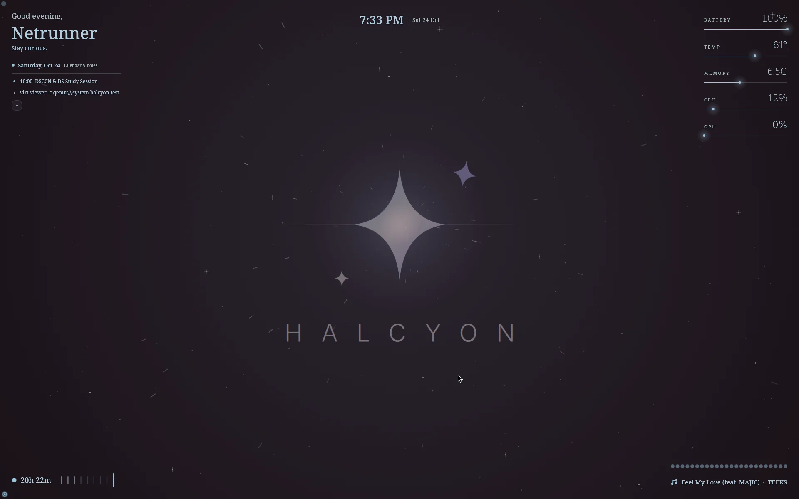

https://github.com/user-attachments/assets/6951fca1-d9d2-4b6d-9731-57c10fa497c4

## What you get

Everything below is how Halcyon looks right after installing, before you change anything.

| | |
|---|---|
| 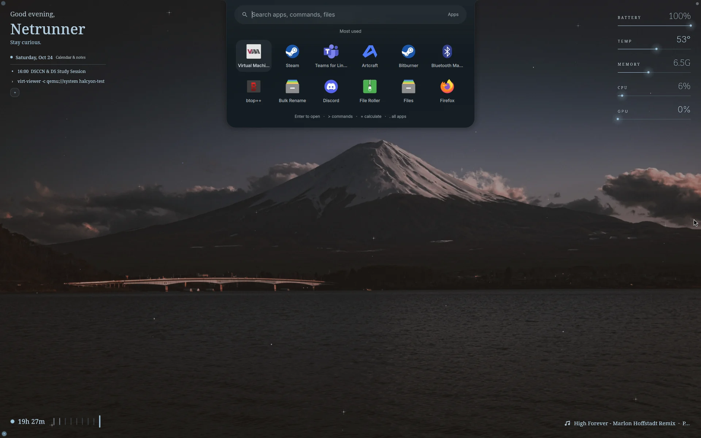 | **One search bar for everything.** Tap <kbd>Super</kbd> and use the arrow keys straight away, or start typing. Type `>` for commands (`>settings`, `>gaming`, a game's name), `=` for a calculator, `.` to see every app. |
| 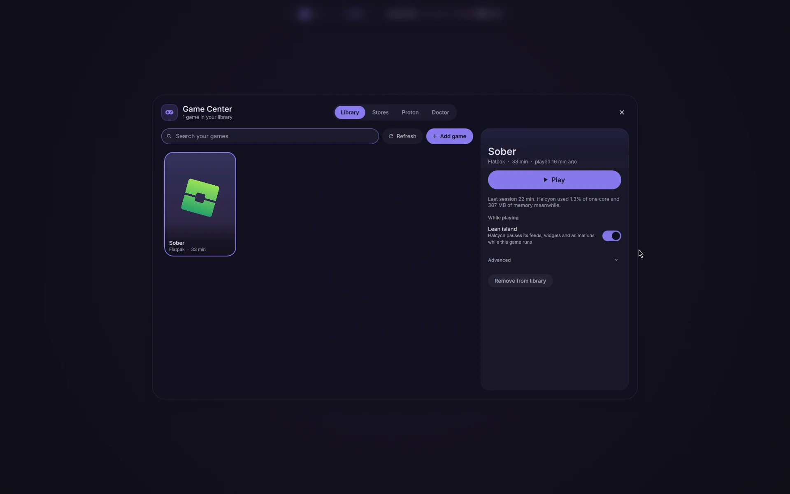 | **Game Center.** Steam games and your own Windows `.exe` games in one library with cover art. It manages Proton versions, checks your system for problems, and switches on gaming mode while you play. The first start shows a download screen with a progress bar. |
| 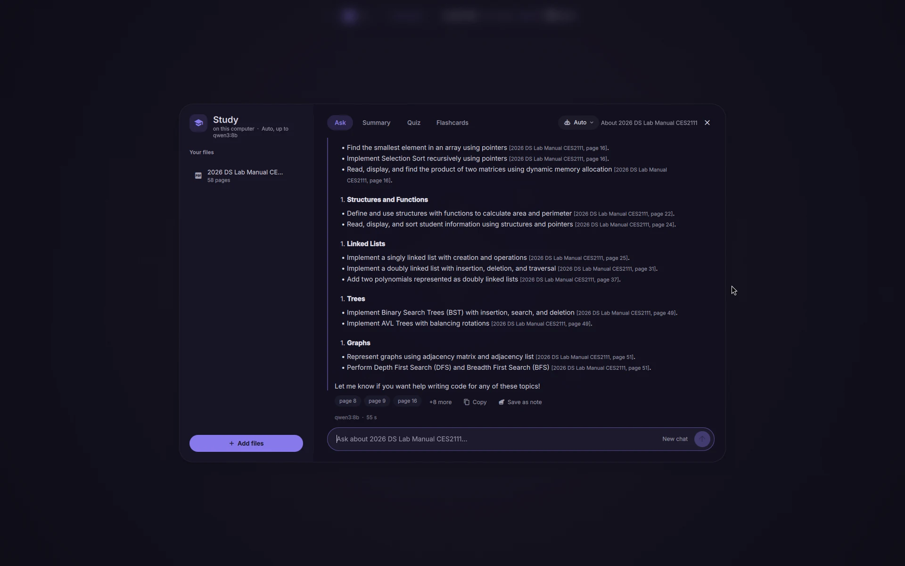 | **Study Center.** Add your PDFs, slides and notes, then ask questions about them or make summaries, quizzes and flashcards, all with a local AI model on your own machine. |
| 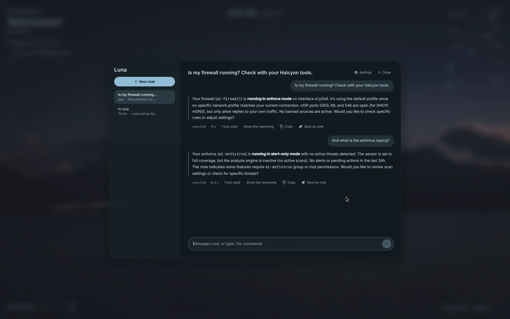 | **Luna, your local assistant.** `>luna` opens a chat with [Luna](https://github.com/X-netrunner/LUNA-AI) in the same style as everything else. Every chat is saved: open an old one and carry on where it stopped. You see the tools she runs, can show her reasoning, and type `/` for commands (`/model` switches her model, `/status` shows the firewall and antivirus at a glance). She knows Halcyon and can look things up in it and, if you allow it, change it. |
| 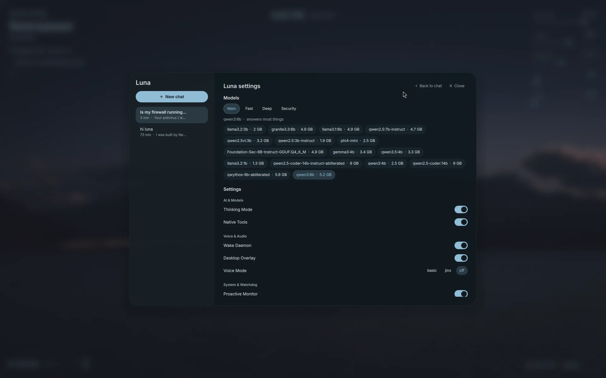 | **Luna's settings are a page, not a config file.** Pick her models (main, fast, deep, security) from what Ollama has, and flip her switches: thinking, voice, the watchdog, her safety gates. **Control Halcyon** is the one switch that lets her change the desktop; it is off until you turn it on. |
| 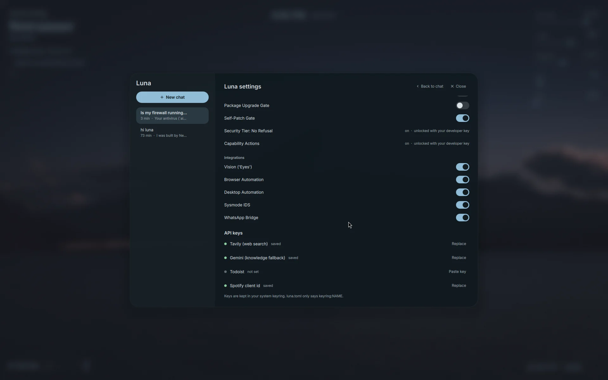 | **Paste a key, Luna stores it.** Web search, Gemini, Todoist and Spotify keys go in with one paste. They are kept in your system keyring and are never sent back to the window or written into `luna.toml`. |
| 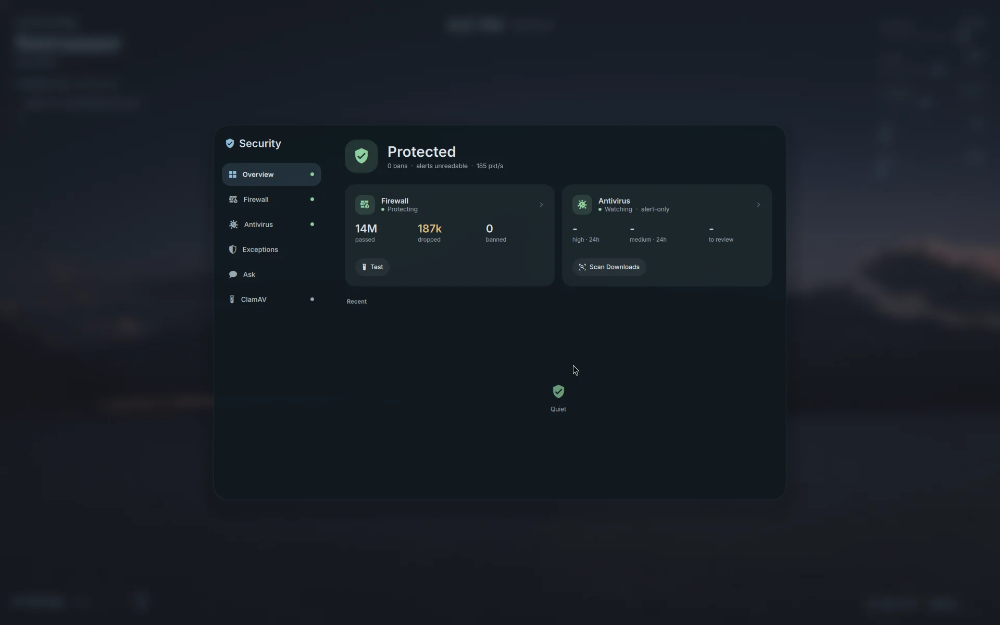 | **Security center.** Firewall, antivirus and ClamAV in one window: what was blocked, what was found, exceptions, and an assistant that answers from live checks. See [the three parts below](#halcyon-ai-firewall-ai-antivirus-and-luna). |
| 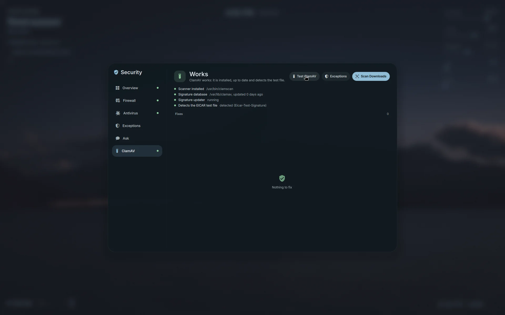 | **ClamAV that checks itself.** One click tests that ClamAV works (installed, fresh signatures, updater running, finds the harmless EICAR test file). After a scan, the local model looks at each finding and says false positive, malicious or unsure. A guess-type signature it judges a false positive can become an exception tied to the file's hash; a named malware signature never does. |
| 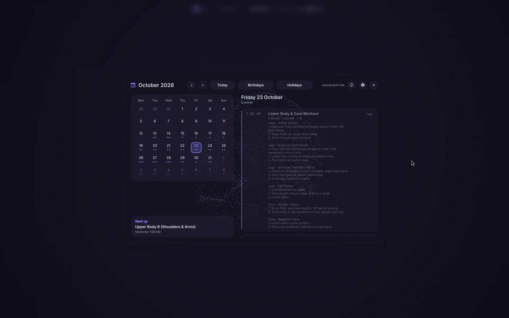 | **Calendar and notes.** Your month, your day's notes and reminders, plus birthdays and holidays. |
| 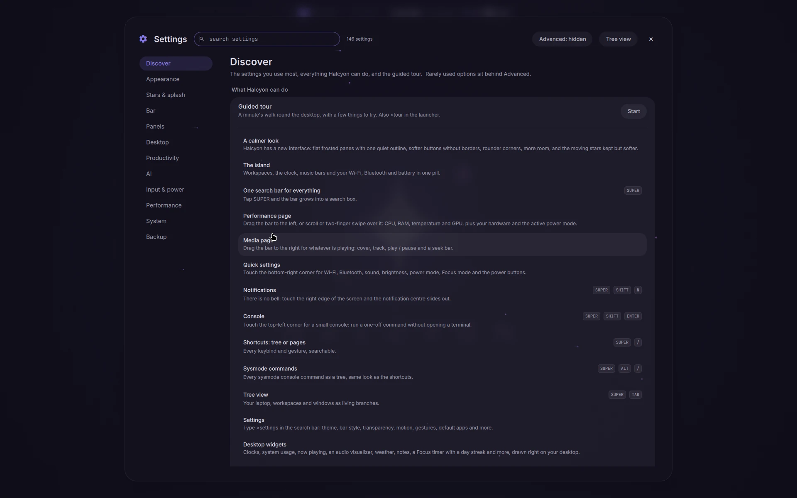 | **Settings that explain themselves.** Every option is searchable. Most of them have a short explanation, and there is a guided tour that shows you around step by step. |
| 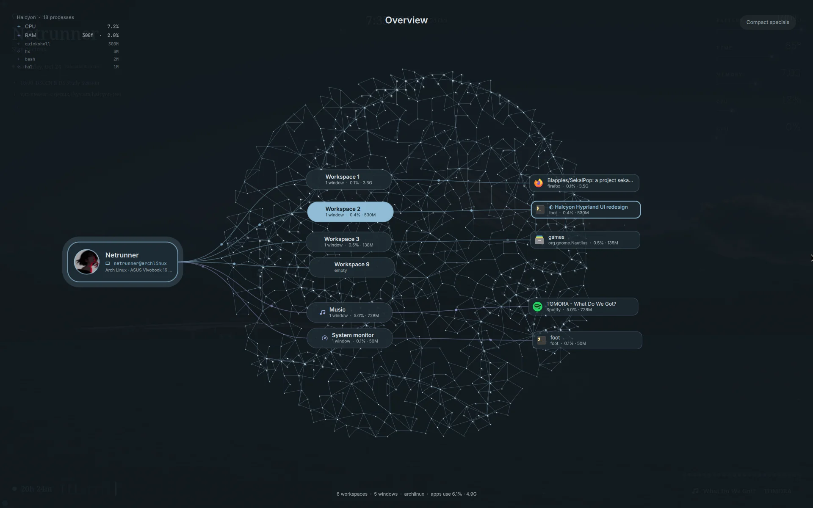 | **Overview.** <kbd>Super</kbd> + <kbd>Tab</kbd> shows every workspace and window as one constellation: click one to go there, drag a window onto another workspace. Halcyon's own CPU and memory use sit in the corner. |
| 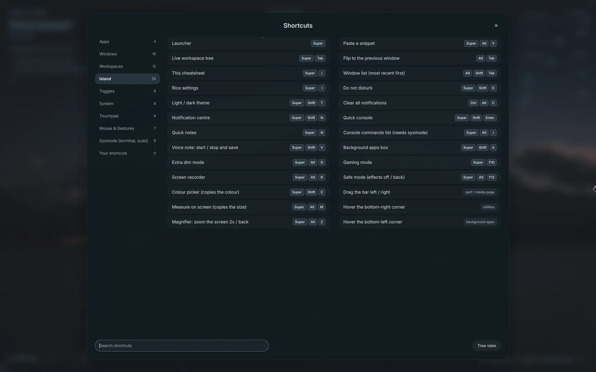 | **Every shortcut in one place.** <kbd>Super</kbd> + <kbd>/</kbd> opens a searchable map of all the key binds, gestures and commands. |

There's more: clipboard history, screenshots, notifications and music in the island, a lock screen with widgets, live wallpapers,
touchpad gestures, focus mode and backups. [Full feature list](docs/features.md).

## Halcyon, ai-firewall, ai-antivirus and Luna

Halcyon comes with three companion projects. They are separate repositories and each one **works on its own**, but they are built to
fit together, and Halcyon is where they fit best.

| Project | What it is | On its own | In Halcyon |
|---|---|---|---|
| **[ai-firewall](https://github.com/X-netrunner/ai-firewall)** | A self-healing eBPF/XDP firewall that replaces ufw: inbound is denied by default, scanners and floods are banned by themselves. | `ai-firewall status`, `top`, `ban`, `open`, `doctor`, `ask` | A Security center page with the live numbers, bans and rules; sysmode sets its posture; Luna can read it and, with your permission, ban or open ports. |
| **[ai-antivirus](https://github.com/X-netrunner/ai-antivirus)** | A behaviour-based antivirus and EDR: it watches what programs do (not only what files contain), with pacman trust, YARA and behaviour rules. Alert-only until you change that. | `ai-antivirus status`, `alerts`, `scan`, `exceptions`, `ask` | A Security center page and an exceptions list; Halcyon's installer gets a narrow exception so its updates are not reported; Luna can read it and, with your permission, scan and add exceptions. |
| **[Luna](https://github.com/X-netrunner/LUNA-AI)** | A local AI assistant in Rust that runs on Ollama: tools, memory, reminders, voice. | `luna` in a terminal (text or the TUI) | The `>luna` window with saved chats, her settings and API keys as a page, and tools that let her read, and with your permission operate, the rest of Halcyon. |

Together they give you things none of them has alone:

- **One place to look.** The Security center shows the firewall, the antivirus and ClamAV side by side, and asks you before anything that needs admin rights.
- **A security assistant that knows your machine.** Ask Luna "is my firewall running?" or "what is the antivirus saying?" and she reads the real status instead of guessing.
- **Control you can switch off.** Luna's three Halcyon tools are separate on purpose: reading is always allowed, changing Halcyon needs the **Control Halcyon** switch in her settings, and firewall and antivirus changes need her developer-signed capability gate and admin rights. Nothing here can be unlocked by the model itself.
- **It stays on your machine.** The models run through Ollama on 127.0.0.1, and the firewall and antivirus send nothing out. Luna only reaches the internet for what you ask of her (web search, Todoist, Spotify, WhatsApp), each one optional and using a key you gave her.

Install them from Halcyon's installer: `./install.sh --firewall ai`, `--antivirus`, `--luna` (each is asked about on a first install, and
you can add one later by running the installer again). [How ai-antivirus differs from ClamAV, and why Halcyon's installer is excepted](docs/antivirus.md).

## Make it yours

Every part has a builder with a live preview, so you can see a change before you keep it.

| | |
|---|---|
| 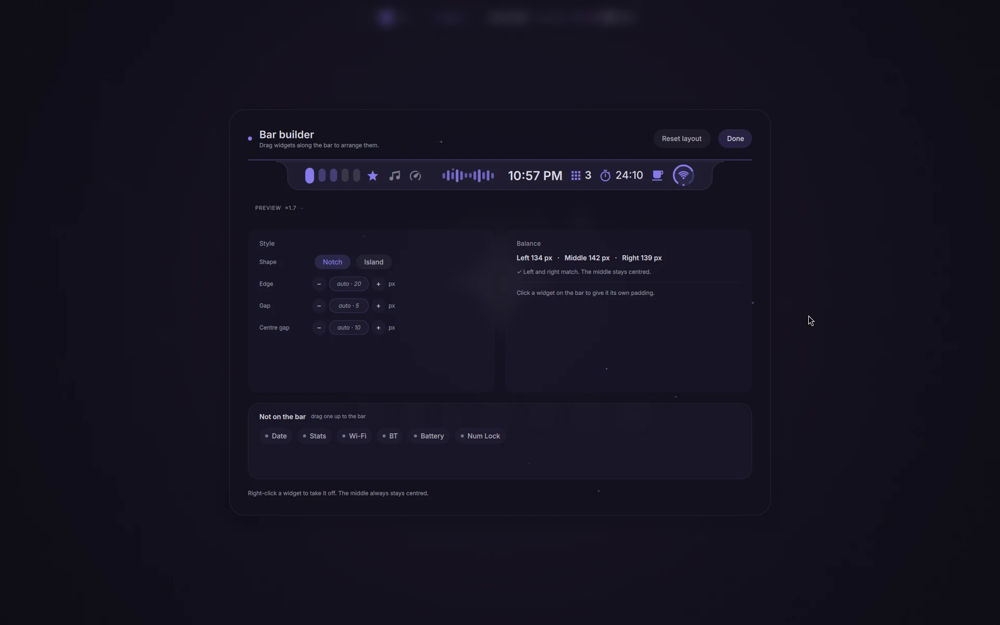 | **Bar builder.** Choose what the island shows and in what order, its size and its style. You can also turn the bar off. |
| 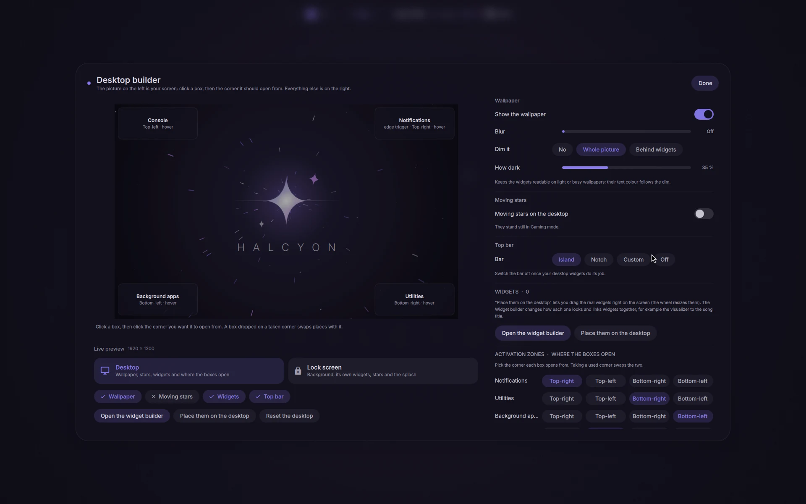 | **Desktop builder.** The wallpaper (a picture, the live sky or a video), the blur and the moving stars. |
| 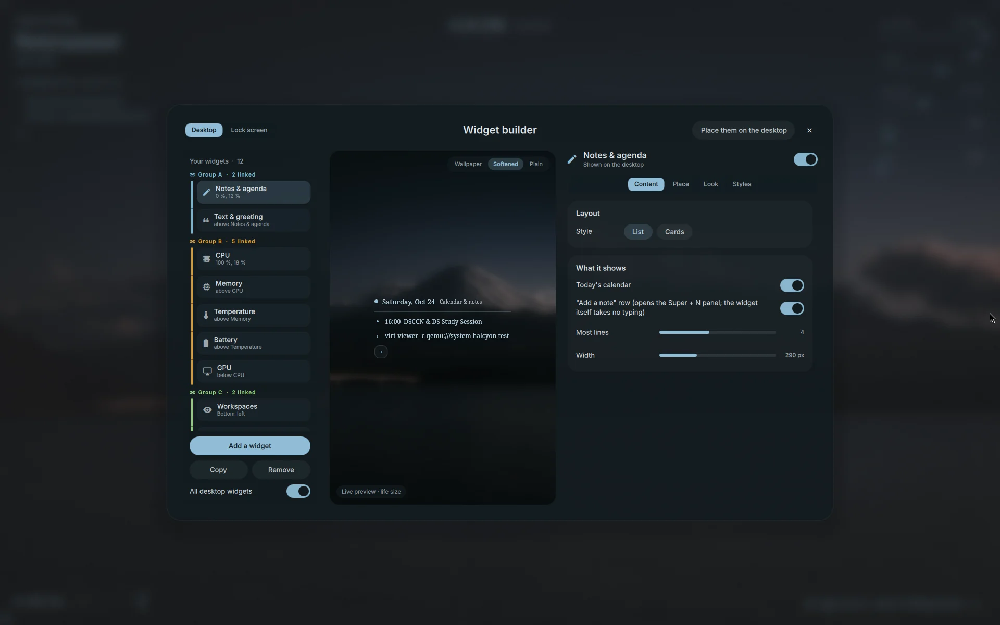 | **Widget builder.** Clock, agenda, system stats, now playing, notes and more. Each one has several layouts, and you can save looks of your own. |
| 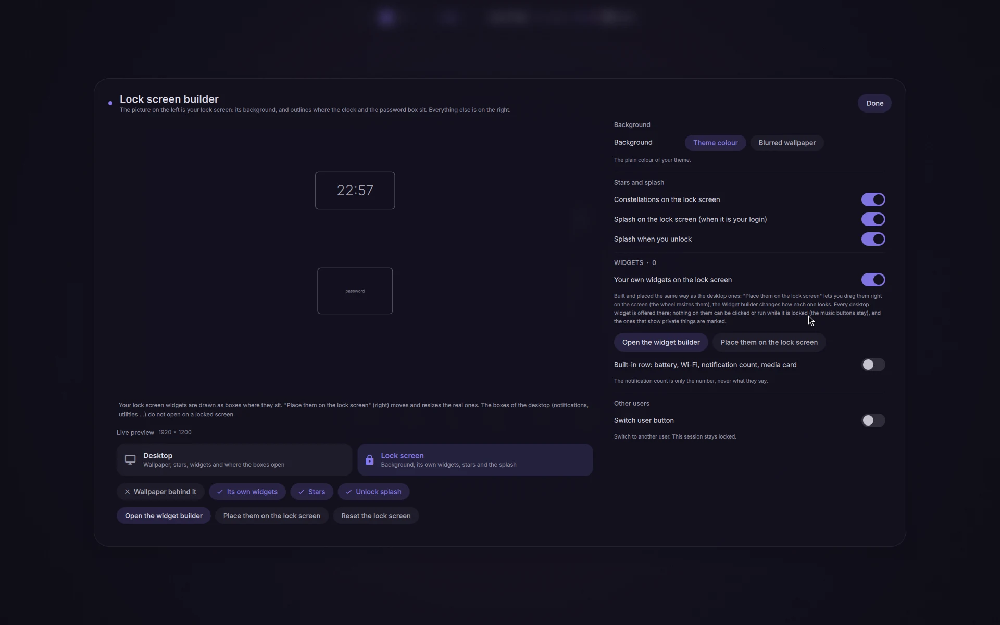 | **Lock screen builder.** The same idea for the lock screen. |
| 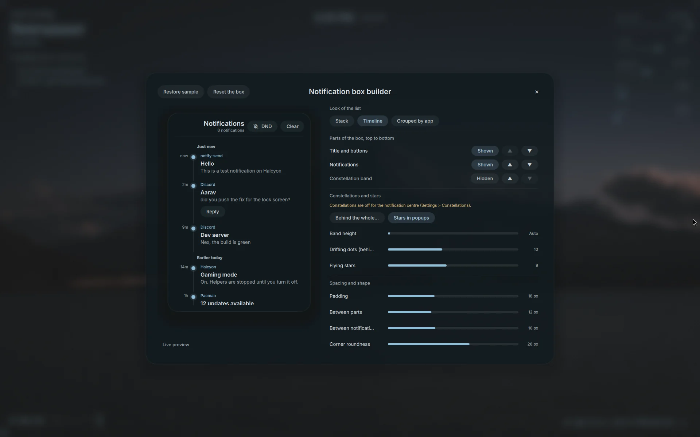 | **Notification builder.** How notifications look and where they go. |

Here's the same desktop after some changes: widgets on the desktop, and the bar turned off.

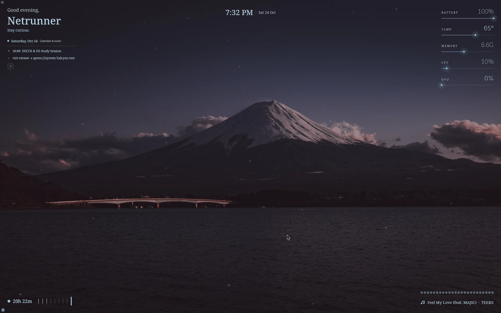

| 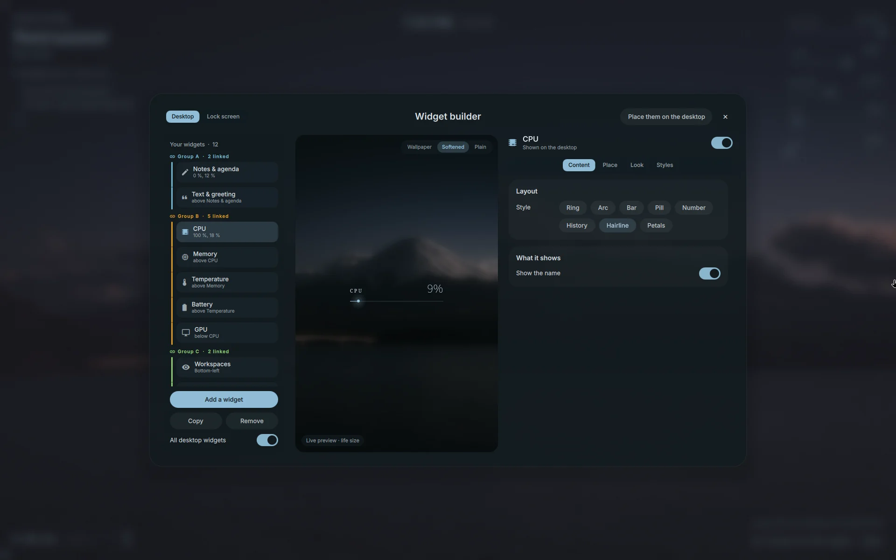 | 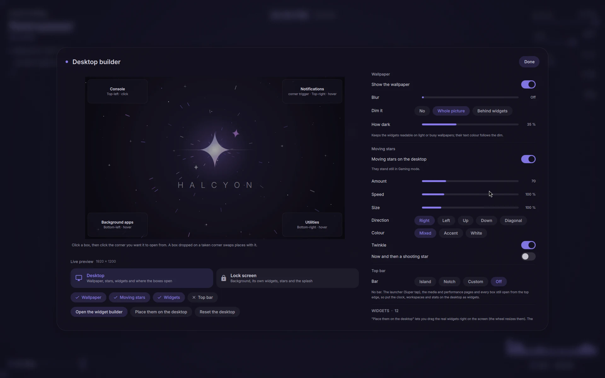 |
|---|---|

## Light on resources

The bar, launcher, notifications, wallpaper (including the live sky), lock screen, widgets and every window you see above run in
**one Quickshell process**. The always-on helpers (system stats, power, gestures) are small Rust programs, and the Python parts only run while
you use them.

Measured on a 16 GB laptop:

| | |
|---|---|
| The island (the whole Quickshell UI), after boot | about **255 MB** |
| The island after a long session with many windows opened | about **400 MB** |
| Its CPU at idle (live sky on, nothing playing) | about **1%** of one core |
| Its CPU with music playing and the live sky animating | about **4%** of one core |
| The whole system after boot | about **1.7 GB** used |

**At the lowest settings** (Resource use: Low, Update speed: Low, constellations and tree view effects off, island animations off,
no live wallpaper or moving stars), the island's idle CPU drops to about **0.5%** of one core. Its memory stays about the same
(250–330 MB), because these settings cut animation and polling, not what gets loaded.

All of these are in Settings > Performance & memory and Settings > Appearance.

## Install

**Requirements:** Hyprland 0.56 or newer (the config is written in
Lua). Arch-based distros (Arch, CachyOS, EndeavourOS, Manjaro...) are the reference: developed and tested on Arch with Hyprland 0.56.2. Other systems (less tested): [Debian testing / sid and Ubuntu 26.10+](docs/install-debian.md), [Fedora 44+](docs/install-fedora.md), and [NixOS through the flake](docs/install-nix.md).

As your normal user:

```bash
curl -fsSLO https://github.com/X-netrunner/Halcyon/releases/latest/download/get.sh && bash get.sh
```

It asks a few short questions (browser, file manager, editor, whether you want the optional extras) and asks for your password only when a
step needs it. If you already have a Halcyon folder, the old copy is backed up to `~/.config/Halcyon-backups` first. Then pick the **Halcyon** session on your login screen. Prefer to read it first? Run `git clone` and `./install.sh --dry-run`.
The dry run shows every step and changes nothing.

**Optional extras you choose at install time:**
- **sysmode**: a security lab with a honeypot, an intrusion detection system (IDS) and hardening. It's off unless you say yes.
- **Safety check**: a one-click system update, malware scan and backup.
- **ai-firewall**, **ai-antivirus** and **Luna**: the [three companion projects](#halcyon-ai-firewall-ai-antivirus-and-luna) (`--firewall ai`, `--antivirus`, `--luna`).

The first two run as root. [How it works](docs/how-it-works.md#install-one-script) says exactly what is installed and why it can be trusted.

## First steps

| Key | Does |
|---|---|
| <kbd>Super</kbd> | Open the launcher |
| <kbd>Super</kbd> + <kbd>/</kbd> | All shortcuts |
| <kbd>Super</kbd> + <kbd>T</kbd> / <kbd>W</kbd> / <kbd>E</kbd> / <kbd>C</kbd> | Terminal / browser / files / code editor |
| <kbd>Super</kbd> + <kbd>Q</kbd> | Close a window |
| <kbd>Super</kbd> + <kbd>1</kbd>...<kbd>9</kbd> | Go to a workspace |
| <kbd>Super</kbd> + <kbd>L</kbd> | Lock |

New here? Open Settings and press **Start** next to *Guided tour*.

## Updating

```bash
~/.config/Halcyon/update.sh
```

If there is nothing new, nothing is touched. Your own changes are kept. If something goes wrong, `update.sh --rollback` goes back to the
previous version.

## Something not working?

Run `~/.config/Halcyon/scripts/halcyon-doctor.sh` and it tells you what's wrong. Games have their own check in Game Center > Doctor.
Please open an [issue](https://github.com/X-netrunner/Halcyon/issues/new/choose) with what it says. Questions and screenshots of
your setup are welcome in [Discussions](https://github.com/X-netrunner/Halcyon/discussions). Want to help? See [CONTRIBUTING.md](CONTRIBUTING.md).

## Learn more

- **[How Halcyon works](docs/how-it-works.md)**: the folders, the Rust helpers, everything the installer does, security notes and updates
- [Why it's built this way](docs/architecture.md) · [Games](docs/games.md) · [Features and settings](docs/features.md) · [Changelog](changelog.md)

## Who made it

Halcyon is written by Srijan ([netrunner](https://github.com/X-netrunner)).

MIT licensed. See [LICENSE](LICENSE).
